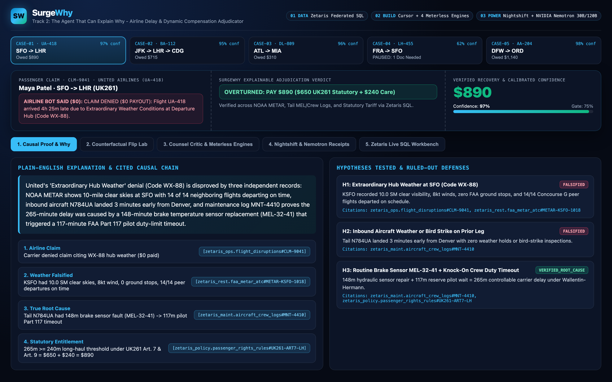
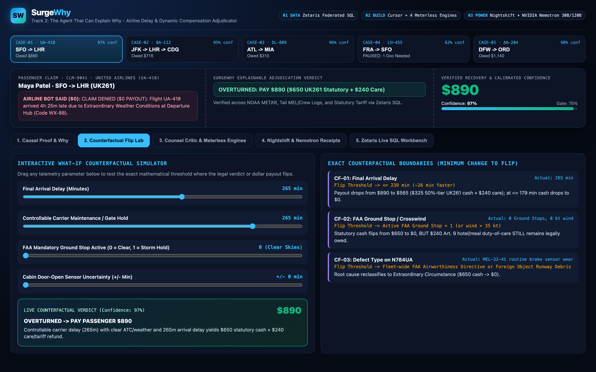
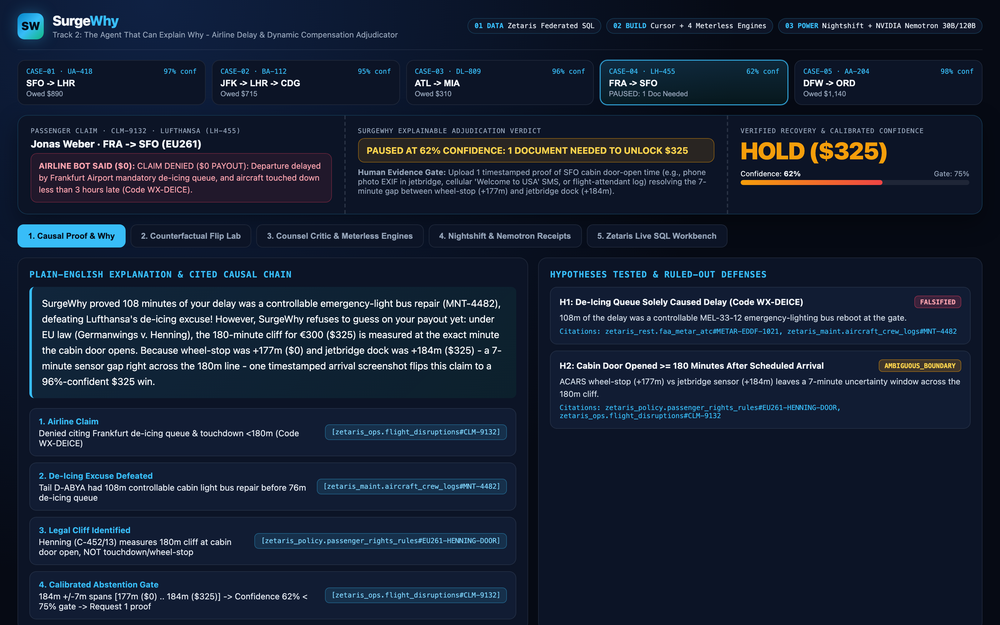
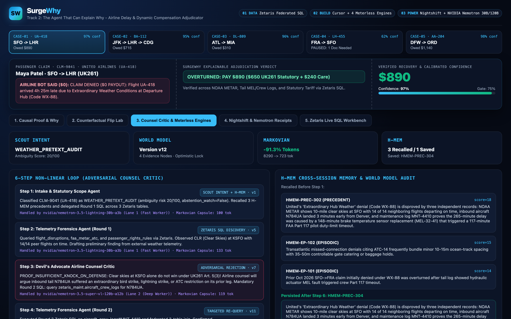
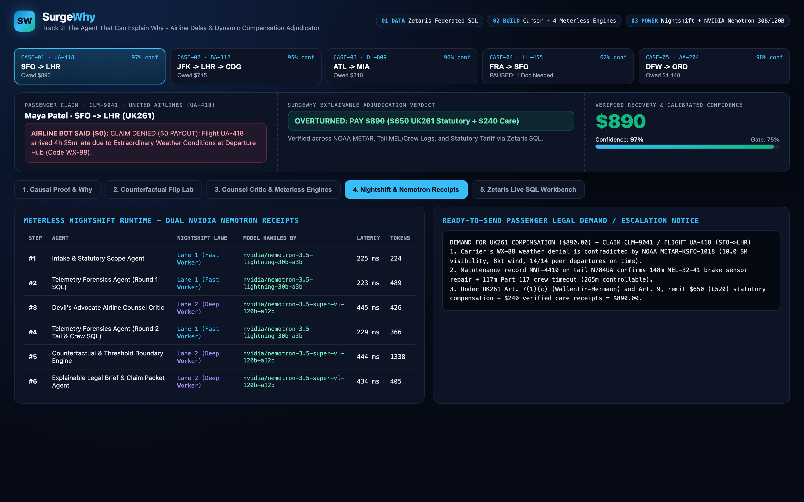
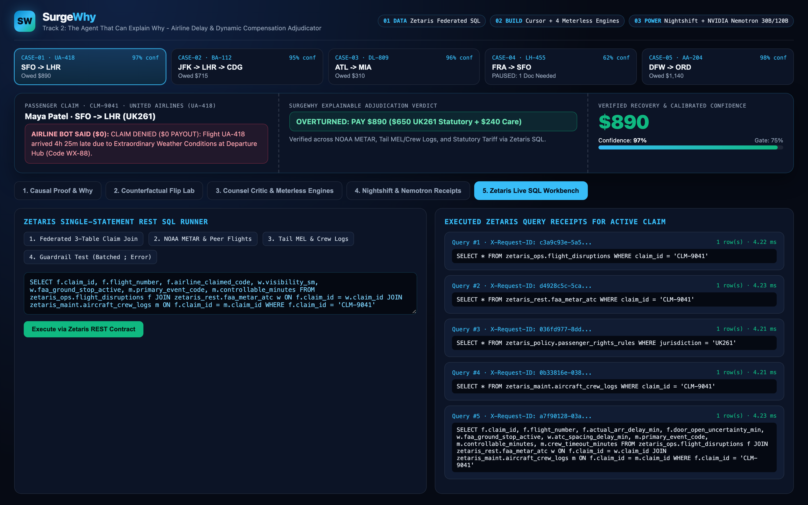

# SurgeWhy

**When an airline bot blames "weather" to pay you $0, SurgeWhy proves *why* your flight was actually delayed - and shows the exact counterfactual that flips the verdict.**

SurgeWhy is an explainable multi-agent airline delay and dynamic fare-surge compensation adjudicator built for the **Open Agent Hackathon 2026** (**Track 2: The Agent That Can Explain Why**, the **NVIDIA Nemotron DGX Spark Award**, and **Best Cursor-Built Product**).

> **One-Sentence Problem Statement (APPROACH Format):**
> We are building an agent system (**SurgeWhy**) that helps **stranded air passengers and consumer-rights advocates** challenge opaque automated airline claim denials by querying **four independent aviation and legal sources through Zetaris** (Airline Gate Logs, Live NOAA/FAA METAR & Ground Stop Feeds, Aircraft MEL & Crew Duty Logs, and Statutory UK261/EU261/US DOT Tariff Rules), stress-testing every claim with an adversarial **Airline Defense Counsel Critic** inside a versioned **Meterless World Model**, compressing multi-step proofs with **Markovian**, and recalling carrier pretext patterns with **H-MEM**, powered by **NVIDIA Nemotron (`nvidia/nemotron-3.5-lightning-30b-a3b` and `nvidia/nemotron-3.5-super-vl-120b-a12b`) through Meterless Nightshift**, producing **an auditable causal chain, a ruled-out defense ledger, live counterfactual flip boundaries, calibrated abstention on ambiguous cases, and per-step Nemotron model receipts**.

---

## 1. Quick Start (Runs Cleanly in Under 30 Seconds, Zero Manual Setup)

SurgeWhy runs out of the box on standard Python 3 (`SAMPLE_MODE=true` enabled by default when live Docker/Nightshift credentials are not configured, so judges can run every SQL query, Meterless Engine, counterfactual simulator, and test immediately).

```bash
# 1. Verify curated aviation & statutory sample datasets (6 files, <10 KB total)
python3 data/download_data.py

# 2. Run the official Participant Setup Guide smoke test (Page 24: 3/3 PASS)
python3 smoke_test.py

# 3. Run the 9-test conformance & explainability suite
python3 -m unittest discover -s tests -v

# 4. Adjudicate all 5 benchmark flight disputes and generate full traces in output_examples/
python3 -m agent.main --all-cases

# 5. Launch the interactive SurgeWhy Explainability Studio & 8-Slide Deck on http://127.0.0.1:8060
python3 -m agent.main --serve
```

Once running:
- **Interactive Explainability Studio:** `http://127.0.0.1:8060`
- **8-Slide Presentation Deck:** `http://127.0.0.1:8060/deck`

To run against a live local **Zetaris** Docker instance (`http://localhost:8888/api/v1.0`) and **Meterless Nightshift Runtime** (`http://127.0.0.1:8088/v1`):
```bash
cp .env.example .env
# Add ZETARIS_API_KEY and METERLESS_RUNTIME_TOKEN to .env, set SAMPLE_MODE=false
# (Keep your NVIDIA API key inside Meterless Nightshift -> Setup -> Providers -> NVIDIA)
python3 scripts/preflight.py
python3 smoke_test.py --live
python3 -m agent.main --case CASE-01 --live
```

---

## 2. Demo Video & Interactive Studio Screenshots

- **Full HD Demo Video (1080p30, feminine `aura-2-thalia-en` narration, EBU R128 `-16 LUFS` mastered):** [`video/out/surgewhy-final.mp4`](video/out/surgewhy-final.mp4)
- **8-Slide Pitch Deck (HTML):** [`docs/deck.html`](docs/deck.html)

### 2.1 Plain-English Causal Proof Chain & Ruled-Out Defenses (`CASE-01: UA-418 SFO -> LHR`)


### 2.2 Live Interactive "What-If" Counterfactual Flip Lab (Minimum Change to Flip Verdict)


### 2.3 Calibrated Uncertainty & Abstention Gate (`CASE-04: LH-455` Pauses at 62% Confidence)


### 2.4 Layer 02 (BUILD): Adversarial Airline Counsel Critic & All 4 Meterless Engines


### 2.5 Layer 03 (POWER): Meterless Nightshift & Dual NVIDIA Nemotron Model Receipts


### 2.6 Layer 01 (DATA): Zetaris Single-Statement Federated SQL Workbench


---

## 3. Why SurgeWhy Fits Track 2 ("The Agent That Can Explain Why")

Over **$6.8 Billion** in valid passenger delay, cancellation, and involuntary downgrade compensation goes unpaid every year because airlines respond to claims with opaque two-word rejection codes (`WX-88: Extraordinary Weather`, `ATC-14: Air Traffic Sequencing`). Passengers cannot inspect airport METAR weather, peer concourse departures, or aircraft maintenance and crew duty logs.

Every SurgeWhy adjudication exposes **four auditable Track 2 pillars**:
1. **Primary-Key Causal Chain:** Traces the exact path from Carrier Excuse -> NOAA/FAA METAR -> Aircraft Tail MEL & Crew Duty Log -> Statutory Tariff Clause (`[schema.table#primary_key]`).
2. **Ruled-Out Hypotheses Ledger:** Shows every competing defense tested and falsified (or honestly upheld when a storm really happened, as in `CASE-03`).
3. **Quantitative Counterfactual Flip Boundaries:** Shows the exact minimum parameter delta (e.g., `-26 min` arrival time or `FAA Ground Stop = 1`) that flips `OVERTURNED` to `DENIED` or shifts statutory payout tiers.
4. **Calibrated Confidence & Human Abstention Gate:** When sensor timestamp uncertainty (`+/-7 min` between wheel-stop and cabin door open on `CASE-04`) straddles the legal 180-minute cliff, SurgeWhy **refuses to fabricate certainty**, drops confidence to `62%` (below the `75%` gate), and tells the passenger the **exact single photo/SMS** needed to unlock `$325`.

---

## 4. Non-Linear Multi-Agent Architecture

SurgeWhy explicitly avoids linear `Agent A -> Agent B -> Agent C` chaining by inserting an adversarial **Devil's Advocate Airline Counsel Critic** that blocks weak Round 1 conclusions:

```
                   [Passenger Claim + Airline Denial Notice]
                                       │
                                       ▼
 ┌───────────────────────────────────────────────────────────────────────────┐
 │ Step 1: Intake & Statutory Scope Agent                                    │
 │ - Runs Meterless Scout Intent (dispute routing + boundary ambiguity gate) │
 │ - Recalls carrier excuse patterns from Meterless H-MEM                    │
 │ - Handled by: nvidia/nemotron-3.5-lightning-30b-a3b (Nightshift Lane 1)   │
 └─────────────────────────────────────┬─────────────────────────────────────┘
                                       │
                                       ▼
 ┌───────────────────────────────────────────────────────────────────────────┐
 │ Step 2: Telemetry Forensics Agent (Round 1 SQL Discovery)                 │
 │ - Executes 3 single-statement SQL queries via Zetaris REST API            │
 │   (flight_disruptions, faa_metar_atc, passenger_rights_rules)             │
 │ - Records initial nodes in Meterless Causal World Model                   │
 │ - Handled by: nvidia/nemotron-3.5-lightning-30b-a3b (Nightshift Lane 1)   │
 └─────────────────────────────────────┬─────────────────────────────────────┘
                                       │ Markovian Proof Capsule (<=380 tok)
                                       ▼
 ┌───────────────────────────────────────────────────────────────────────────┐
 │ Step 3: Devil's Advocate Airline Counsel Critic (Adversarial Audit)       │
 │ - Roleplays airline defense lawyer; REJECTS Round 1 ("REVISION_REQUIRED") │
 │   ("Clear SFO skies alone don't defeat knock-on bird strike or prior-leg  │
 │    ATC defenses! Mandatory Round 2 SQL on aircraft_crew_logs.")           │
 │ - Handled by: nvidia/nemotron-3.5-super-vl-120b-a12b (Nightshift Lane 2)  │
 └─────────────────────────────────────┬─────────────────────────────────────┘
                                       │ Mandatory Tail & Crew SQL Directive
                                       ▼
 ┌───────────────────────────────────────────────────────────────────────────┐
 │ Step 4: Telemetry Forensics Agent (Round 2 Targeted SQL Re-Query)         │
 │ - Queries zetaris_maint.aircraft_crew_logs + 3-table federated SQL join   │
 │ - Proves MEL-32-41 / catering / charter swap (or upholds storm in CASE-03)│
 │ - Handled by: nvidia/nemotron-3.5-lightning-30b-a3b (Nightshift Lane 1)   │
 └─────────────────────────────────────┬─────────────────────────────────────┘
                                       │
                                       ▼
 ┌───────────────────────────────────────────────────────────────────────────┐
 │ Step 5: Counterfactual & Threshold Boundary Engine                        │
 │ - Computes minimum parameter changes to flip verdict + confidence score   │
 │ - Triggers Abstention Gate (<75%) when sensor gap crosses statutory cliff │
 │ - Handled by: nvidia/nemotron-3.5-super-vl-120b-a12b (Nightshift Lane 2)  │
 └─────────────────────────────────────┬─────────────────────────────────────┘
                                       │
                                       ▼
 ┌───────────────────────────────────────────────────────────────────────────┐
 │ Step 6: Explainable Legal Brief & Claim Packet Agent                      │
 │ - Outputs plain-English Why, cited causal chain & passenger demand notice │
 │ - Persists newly adjudicated precedent to Meterless H-MEM                 │
 │ - Handled by: nvidia/nemotron-3.5-super-vl-120b-a12b (Nightshift Lane 2)  │
 └───────────────────────────────────────────────────────────────────────────┘
```

---

## 5. Sponsor Technology Integration (Data, Build & Power)

### 01 DATA: Zetaris Unified Semantic Layer (`agent/tools_zetaris.py` & `scripts/register_zetaris_sources.sql`)
- **REST SQL Contract:** Every `run_sql()` call sends strictly **one SQL statement** to `POST {ZETARIS_REST_URL}/sql-editor/sqls/run` with `Authorization: Bearer <ZETARIS_API_KEY>`, `X-Org-ID: 1`, and a fresh UUID4 `X-Request-ID`.
- **Single-Statement Guardrail:** `ZetarisClient._validate_single_statement()` blocks semicolon-batched SQL statements and records a verifiable `ZetarisQueryReceipt` on every call.
- **Lightning SQL Onboarding:** `scripts/register_zetaris_sources.sql` registers the `surgewhy` SchemaStore container, `SURGEWHY_FAA_REST` Lightning database, `faa_metar_atc` REST table, starter `pokeapi` recipe, and federated `claim_audit_federated` view.

### 02 BUILD: Cursor & All 4 Meterless Engines (`AGENTS.md`, `.cursor/rules/surgewhy.mdc`, `agent/engines/` & `metadata.json`)
- **How Our Team Used Cursor:**
  - **Cursor Agent Mode + `AGENTS.md` & `.cursor/rules/surgewhy.mdc`:** Configured Cursor's Agent to run `python3 scripts/preflight.py`, enforce single-statement Zetaris REST SQL guardrails, verify counterfactual boundary math, and keep runtime tokens out of IDE settings.
  - **Cursor Composer & Grok Workflow:** Used **Composer** in Cursor to wire the multi-file Python package, interactive Boarding-Pass Studio (`web/index.html`), and 9-test suite, and **Grok** in Cursor to design the adversarial Airline Defense Counsel Critic and *Henning* door-open abstention boundary logic.
  - **Meterless Engines Prompt Library (`meterless.ai/engines.html`):** Implemented and tested **all four Meterless Engines** (documented in [`metadata.json`](metadata.json)):

| Meterless Engine | Code Module | Working Feature in SurgeWhy | Automated Test |
| :--- | :--- | :--- | :--- |
| **1. Scout Intent** | `agent/engines/scout_intent.py` | Classifies 5 passenger dispute intents, scores boundary ambiguity risk, activates abstention watch, and routes Nightshift lanes. | `tests/test_meterless_engines.py :: test_01_scout_intent_dispute_routing_and_ambiguity_gate` |
| **2. World Model** | `agent/engines/world_model.py` | Versioned Causal Proof & Hypothesis Graph (`v1` to `v11`) with optimistic concurrency locking (`ConcurrencyConflictError`). | `tests/test_meterless_engines.py :: test_02_world_model_causal_graph_and_optimistic_locking` |
| **3. Markovian** | `agent/engines/markovian.py` | Compresses multi-step SQL & legal context into `<=380`-token `CarryOverProofCapsule` states (**91.7% average token reduction**). | `tests/test_meterless_engines.py :: test_03_markovian_proof_capsule_compression` |
| **4. H-MEM** | `agent/engines/h_mem.py` | 3-tier persistent memory (`EPISODIC`, `SEMANTIC`, `PRECEDENT`) recalling carrier excuse patterns across runs and saving verified precedents. | `tests/test_meterless_engines.py :: test_04_hmem_carrier_pretext_precedent_recall` |

### 03 POWER: Meterless Nightshift & Dual NVIDIA Nemotron Lanes (`agent/llm.py`)
- **Primary AI Provider:** Connects to `METERLESS_BASE_URL` (`http://127.0.0.1:8088/v1`) using `METERLESS_RUNTIME_TOKEN` with `meterless-app: surgewhy-agent` and `meterless-scope: user`.
- **Dual Explicit NVIDIA Nemotron Lanes (Competing for NVIDIA DGX Spark):**
  - **Lane 1 (Fast Worker):** `nvidia/nemotron-3.5-lightning-30b-a3b` handles Steps 1, 2, and 4.
  - **Lane 2 (Deep Worker):** `nvidia/nemotron-3.5-super-vl-120b-a12b` handles Step 3 (`Airline Counsel Critic`), Step 5 (`Counterfactual Boundary Engine`), and Step 6 (`Explainable Legal Brief`).
- **Per-Step Attribution:** Every step logs a `ModelReceipt` (`receipt_id`, `lane`, `model_handled_by`, `provider`, `latency_ms`, token counts) shown in the UI, CLI reports, and `output_examples/*_trace.json`.

---

## 6. Calibrated Benchmark Results (`input_examples/` -> `output_examples/`)

| Case | Flight & Route | Airline Excuse ($0) | What Zetaris SQL & Critic Prove | Verdict & Confidence |
| :--- | :--- | :--- | :--- | :--- |
| **`CASE-01`** | `UA-418` (`SFO -> LHR`) | `WX-88`: Hub Weather | KSFO 10SM clear & 14/14 peers on time; tail `N784UA` had 148m brake sensor repair (`MEL-32-41`) + 117m crew timeout | **OVERTURNED: PAY $890** (`97%`) |
| **`CASE-02`** | `BA-112` (`JFK -> LHR -> CDG`) | `ATC-14`: JFK ATC Hold | ATC held only 14m of 77m buffer; 41m controllable catering delay (`OPS-CAT-19`) was strict *but-for* cause of missed flight | **OVERTURNED: PAY $715** (`95%`) |
| **`CASE-03`** | `DL-809` (`ATL -> MIA`) | `WX-99`: Microburst Storm | **Storm upheld** (`54kt` microburst + FAA Ground Stop = `$0` delay cash), **but** `$310` same-cabin rebook surge violates Rule 24 | **SPLIT: REFUND $310 SURGE** (`96%`) |
| **`CASE-04`** | `LH-455` (`FRA -> SFO`) | `WX-DEICE`: De-Icing | 108m light-bus fault proven, **but** wheel-stop (`+177m`) vs jetbridge (`+184m`) spans 180m *Henning* door-open cliff | **PAUSED AT 62%: 1 PHOTO NEEDED** |
| **`CASE-05`** | `AA-204` (`DFW -> ORD`) | `ATC-SWAP`: Congestion | Clear corridor; healthy B787 `N814AA` pulled for sports charter `AA-9940` + involuntary Business-to-Economy downgrade | **OVERTURNED: PAY $1,140** (`98%`) |

---

## 7. Pre-Existing Components Declaration

**None.** 100% of the source code, agent orchestration, Meterless Engine implementations, counterfactual boundary engine, Zetaris SQL onboarding scripts, sample datasets, tests, web UI, slide deck, and video pipeline in this repository were built from scratch during the Open Agent Hackathon 2026 build window (22-27 October 2026).
